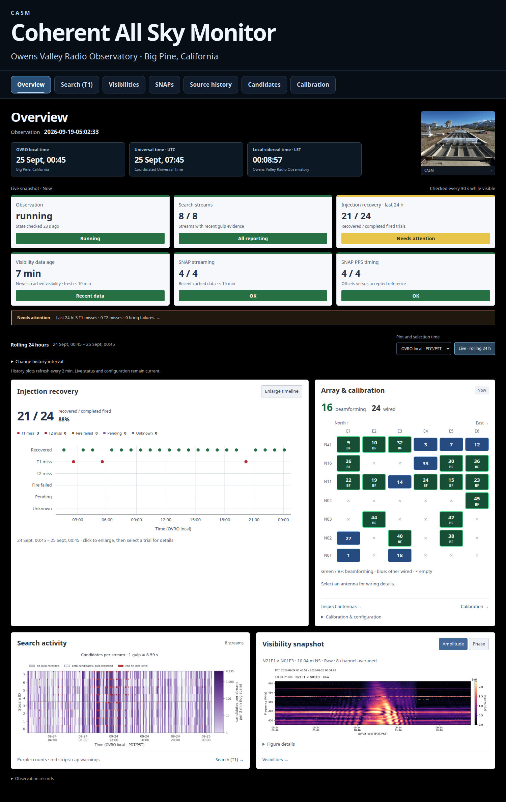
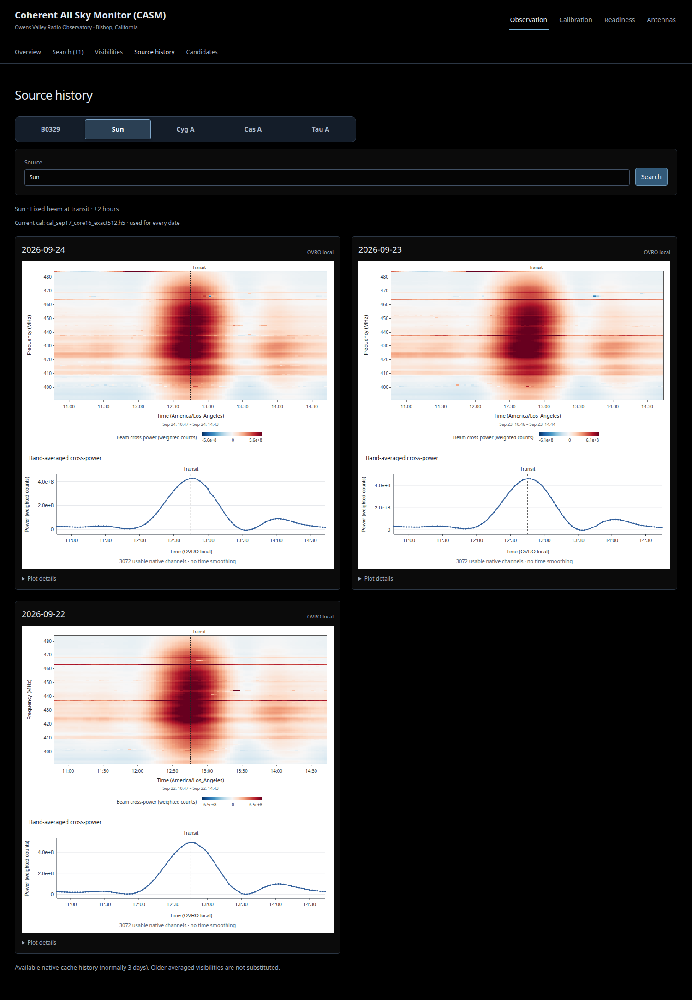

# Investigate an observation

The dark monitoring workspace runs at **http://localhost:8061/**.
The tabs are Overview, Search (T1), Visibilities, SNAPs, Source history,
Candidates and Calibration. The legacy web services on 8060 and 8050 were
stopped and disabled September 25, 2026. Collectors, workers, T2/T3 processing,
scratchpad on 8501 and Medusa remain unchanged. Forward port
8061 to use the preview remotely. The page background is black and no Plotly
code is loaded. Imaging is removed from this preview's navigation and frontend
routes because the operator rejected its current plots. Other viewers and
the existing scientific/backend imaging implementation remain unchanged.

Navigation labels are larger and semibold, with pale text on dark-blue tab
surfaces. The selected tab uses a brighter fill, border and underline; keyboard
focus has its own outline. Tabs wrap on narrow screens without hiding names.

The opening **Overview** replaces Injection recovery. Four live status cards
show observation state, search streams, rolling-24-hour injection recovery and
cached-visibility age. An attention strip links to checks that need review.
The cards refresh every 30 seconds while visible and remain labelled **Now**.
Stale or unavailable evidence cannot remain green.
The live recovery card is green, labelled **All recovered**, at 100% of a
nonempty completed-fired set, with no firing failures, pending trials or unknown
outcomes. For partial recovery, it is yellow (**Needs attention**) for 18 or more
recovered trials in 24 hours, orange for 12–17 and red below 12. Missing or empty
evidence stays unknown; stale/incomplete counts cannot turn green. These display
bands do not apply to shorter historical intervals or individual trial markers.
The top-right CASM photograph opens in the same click-to-zoom viewer as the plots.
It is a supplied still image, not a live camera; the complete frame is retained.
The title names the telescope **Coherent All Sky Monitor (CASM)**, with
Owens Valley Radio Observatory, Big Pine, California on a separate location line.

Below, injection recovery and current array/calibration context sit side by
side. A white timeline shows each trial's recorded outcome; click a marker for
details, or enlarge the timeline and zoom. The station map
shows all wired inputs: green/BF marks the inspected nonzero coherent-beam weights
in the latest recorded deployment; blue marks other wired inputs. Unknown
membership is explicit. Colours describe membership, not antenna health.
Recorded weights membership and the ledger calibration do not prove runtime activation.

The bottom row shows one purple stream-count heatmap and one raw reference-baseline
dynamic spectrum, with amplitude/phase selection. Click plots to enlarge;
follow their links to Search or the detailed visibility inspector with the same
interval. A single reference baseline is not a whole-array health test.
All history panels share the selected interval and time zone, default rolling
24 hours with two-minute refresh while visible. A historical selection pauses
history, not the live cards. **Live · rolling 24 h** restores rolling.
Automatic views use bounded cache reads only; no injection or telescope job starts.

## Current page and resource use

The Overview below was captured on September 25, 2026 in OVRO local time from
the working preview. It is a saved example, not a live status image. The monitor
README includes current Search, Visibilities, SNAPs, Candidates and source-history
screenshots; its `docs/screenshots/2026-09-25-latest/manifest.json` records capture
times and image hashes. No Calibration actions or hardware reads were requested.



The September 24 warm-cache sample measured about 0.6 GiB of preview-process resident memory
and 0.2% of one CPU core over a quiet 20-second interval. Plot rendering causes
short CPU bursts; first native source-date loads took about 15 seconds. These
are shared-host measurements, not a cold-load capacity test. The preview's
4 GiB service limit includes filesystem cache. Collector and offline workers
are separate services; their cgroup totals can contain much more file cache
than their main processes' resident memory.

The October 6 status-query fix replaces whole-history scalar scans with indexed
latest-value lookups. Local warm Overview requests fell from about two seconds
to about 60 ms; the first request after restart still takes longer. No data,
freshness thresholds or acquisition cadence changed. Fingerprinted frontend
assets now have explicit immutable browser caching; HTML requires revalidation
and APIs do not inherit the static-asset cache policy. Timings and reproduction are in the monitor's
`docs/resources-and-storage.md`, with private before/after measurement files.

The subsequent October 6 SSH-focused update restores recent Overview, Search,
Visibilities and SNAPs plots and controls when returning to a tab. A bounded
browser memory cache is cleared on full reload. Live status expires on its
normal cadence; failed refreshes remain visible and cannot keep a cached green
verdict. Plot timestamps and displayed intervals stay attached to their data.
Search's stream boxes load independently of its larger figure. Inactive pages
stop polling; hidden tabs pause periodic reads, and playback stays user-driven.

Visibility spectra request no dynamic images until that view is selected;
each quantity and auto-power scale loads on demand with the same scientific
data and axes. All quantities, channels, wired inputs, reference selection,
zoom, downloads and saved playback remain available. SNAP entry avoids the
duplicate initial spectra request. Text responses are compressed, concurrent
identical reads are shared, and completed scientific plot URLs are immutable.
These changes affect the web service only, not acquisition or deployed weights.

Preview products live under `/home/casm/scratch/casm-observation-preview` on
the root disk: `science/` for PNG/NPZ/metadata, `t1_products/` for Search PNGs,
`snap_views/` for saved SNAP renders, and `calibration/` for the separate worker.
This tree measured about 1.5 GiB. Production input caches remain under
`/mnt/nvme3/casm_monitor`; the T2 ledger and registry on NVMe5 are read-only
inputs to these pages, not where the preview writes new plot products.

Native/avg8 shard TTLs are three/60 days. **They do not expire preview render
files**: those currently accumulate without an automatic reaper. Source-beam
and array-overview responses are bounded memory caches. Source history loads
on selection/search, separate from the rolling overview refresh.

Exact counters, capture timestamps/hashes and limits are recorded in
`casm_monitor/docs/screenshots/2026-09-24/measurements.json`; the owning guide is
`casm_monitor/docs/resources-and-storage.md`. Regenerate the evidence with
`casm_monitor/scripts/capture_monitor_docs.py`, not with mocked browser results.

## Classify candidates

**Candidates → Browse** keeps the recent plot grid and right-hand selector.
Enter your name once, then use **Classify** for a large plot and a fixed review
queue. Labels are FRB, Pulsar, Solar, RFI, Noise and Unsure; Cannot assess records
missing/bad data separately. Optional RFI descriptors are Narrowband, Broadband,
Bursty, Frequency comb, Swept/drifting and Repeating in time. Multiple selections
describe bandwidth and time behaviour separately. Class buttons save immediately;
automatic advance defaults on. RFI pauses for details, then **Save RFI & next**
continues. The visible candidate list and badges refresh every five seconds, with
the next two plots and metadata prefetched. Incoming events leave the queue fixed
until **Refresh queue**. Undo
retains revision history. Each reviewer gets their own class-coloured badge;
different labels remain visible instead of replacing one another.
Classifier figures fill their panel width at the original aspect ratio, with
page scrolling for taller images. Click a figure for zoom and download.

Names are self-declared, not authenticated accounts. Classify can hide others'
votes until your first assessment. Browse still displays them, so this workflow
does not establish a blinded review. Human FRB labels are assessments and do not
promote candidates into the production FRB catalog or affect T2/T3.

The separate durable database defaults to
`/mnt/nvme3/casm_candidate_annotations/annotations.sqlite3`. Reviewed PNGs,
metadata and available detection-beam filterbanks are copied into its artifact
directory; missing/oversize filterbanks are explicit. Local SQLite backups
supplement the WAL database, but off-host backups of the complete directory are
still required for disk-loss protection. No annotation retention TTL is applied.
**Export labels** provides JSONL revisions and evidence manifests for later ML
dataset construction. Queue filters cover the loaded list; exports include all
saved reviews. The owning API, byte limits and backup procedure are in
`casm_monitor/docs/candidate-annotations.md`.
New reviews use taxonomy version 2; prior version-1 annotations are unchanged.

The October 6 classification update (`casm_monitor` commit `82152c7`) was checked
with temporary-database API tests and a multi-reviewer browser workflow, including
default advance, RFI details, failed saves, undo, stale tabs and responsive layouts.
The browser check adds 150 ms to metadata/image requests and verifies that advancing
to a prefetched plot issues no extra metadata read. No test labels were entered in
the live store.
The full-width sizing follow-up (`4fcb27e`) verifies image proportions and panel
fit across desktop and mobile sizes without changing saved plots or annotations.
The source snapshot preflight still finds the previously recorded missing
calibrator modules and revision drift; that historical API snapshot is unchanged.

## Start with recovery and search pressure

Overview retains injection outcomes, trial details, product freshness and array
context. Completed fired trials,
pending trials and firing failures are separate. A missing ledger is
unavailable, not zero failures. The seven-day trend uses UTC dates; the headline
is a rolling interval. Read [injection recovery](injection-recovery.md) before
interpreting a saved replay as live search evidence.

Open **Search (T1)** to see the past 24 hours immediately, then change the interval
if needed. Inspect emitted candidates per stream, beam/time, DM/time and width
distributions. The stream title includes the approximate 8.59-second gulp.
Stream and DM heatmaps show counts per time bin (3 minutes in the default
24-hour view), with logarithmic pale-lavender-to-deep-purple colour scales:
higher counts are darker.
All three panels share the palette and range, from 1 to their largest displayed
count (2 when all counts are zero or one). Colourbars label decades and the exact
maximum, omitting nearby decade labels to keep the maximum readable. The DM
panel counts candidates per DM bucket across all streams, without normalising
each time column. Across all three time panels, off-white means zero recorded
candidates with gulp evidence; grey means no recorded gulp or candidates.
Beam cells use their parent stream's gulp evidence; DM cells use any stream's.
This does not establish whether an individual beam was processed, especially
during capped gulps. Hella's 10,000 raw-peak cap applies
per gulp. Stored candidates are post-clustering: their count cannot establish
whether the raw-peak cap was reached. Red strips on the stream panel show
explicit cap warnings from the gulp log ledger without hiding the count colours.
The top y-axis is stream ID (0–7), each combining 64 beams. A red strip at
the upper edge flags the whole stream/time bin, not a beam position. Candidate
counts are not corrected for skipped beams. Colourbar labels wrap onto two lines.
Log coverage is bounded, not guaranteed full-day coverage. No warning does not prove
a cap-free day. Follow the interval link into visibilities to inspect frequency
structure. RFI, satellites, bad channels and storage problems are investigation
hypotheses until supported by evidence.
Both DM displays use logarithmic spacing over 10–1000 pc cm^-3 by operator
choice. The bottom histogram keeps linear counts per existing log-spaced bin,
with the y-axis labelled "Candidates".
The width histogram shows indices 0–6 with integer ticks and linear counts;
spare width bins 7–8 remain in stored/API evidence, outside the display and its
scaling. The September 25
read-only configuration check confirmed that all eight streams search 0–1000;
the 0–10 bucket is omitted only from the DM figures and their scaling, remaining
in stored/API evidence and the stream/beam totals. Stored edges
and counts are unchanged; the approximately 922–1122 bin keeps its full count
but ends visually at the 1000 display limit. No within-bin split is inferred.
All bins, including those outside the displayed range, remain in evidence JSON.
No production search limit or collector setting changed.

The white-background Matplotlib figures match Visibilities, with dark labels,
clear time-zone/unit labels, subtle gridlines and muted-blue histograms. Click the
figure for the same zoom, Fit and pan controls; zoom keeps the selected PNG
and interval fixed and does not reread or rebin data. Downloads and the link
to inspect those times in visibilities remain available. The page still
refreshes the rolling window every five minutes. The off-white stream cards use
dark text and full-width coloured status bands with white labels: green OK,
amber late, red silent, grey unknown. Matching top borders reinforce the status.
Gulp age, observed/expected gulps per hour and empty-gulp fraction
remain visible; missing evidence is not displayed as zero. Cards wrap on phones.

## Read the array snapshot

**Visibilities → History** opens the saved array viewer directly, paused; scrub,
step or press Play. There is no intermediate page or Video playback entry button.
Closing returns to Live, the default. Start with 24 hours, or select 48 hours, Last week
and a UTC end date. All four visibility quantities and compact/SNAP/station
arrangements are available. Changing the reference antenna keeps the exact
selected time, pauses, and buffers V(target, reference); it does not normalize
other baselines. Spectra advance integrations or show the selected rolling
average. Dynamic spectra and the upper-triangle matrix slide a fixed panel
window, separate from the playback period. Scales stay fixed during playback;
real gaps stay blank. Visibility speeds run from 0.5× to 32× and show estimated
full-movie/remaining times from saved frame counts, excluding buffering or slow
rendering. Every saved integration is retained; SNAP speeds are unchanged.
Saved UTC/local/LST, stepping, speed, Loop and clickable
zoom/download are included. The player reads numeric cache chunks, with no
per-frame plot-image request or hardware operation. Click a panel to pause and
enlarge it, then Play inside the zoom viewer to watch only that baseline.
Closing returns to the array at the same time, paused; Download pauses before
saving the current frame. Enlarged visibility playback preserves its 16:9
dynamic-spectrum frame; enlarged SNAP playback preserves the autos' 324:192
spectrum frame. Display zoom scales both dimensions, and short windows scroll
instead of flattening the plots. The array grids are unchanged. API, budgets and estimator
details: `casm_monitor/docs/visibility-playback.md`.
Compact visibility movies now use at most four panels per row, with taller
figures and scrolling when needed. Small screens use fewer columns. The live
compact layout is unchanged; SNAP order and the physical station grid retain
their own layouts.

The main navigation is a single row: Overview, Search (T1), Visibilities, SNAPs,
Source history, Candidates and Calibration. There is no top-right tab group or
Readiness tab. Labels are text-only, with a high-contrast selected underline.
The larger title/Big Pine location and separate local, UTC and local-sidereal clocks frame the
Overview. All three array maps use larger keys on white cards: green for
recorded beamforming members, blue for other wired inputs, × for no antenna.
Map clicks only show/hide plots. Configuration details remain expandable.
Visibilities and SNAPs have a shallower header and wide compressed maps so the
first plots appear sooner. Touch targets remain larger on coarse-pointer devices.
The Overview trial-history/seven-day table disclosure is removed. Click its
injection timeline for zoom, then a trial for details. Data figures throughout
the current routes use the shared Fit/zoom/pan viewer, including candidate
statistics, Calibration galleries and saved review images; maps retain selection.


**Visibilities** opens larger white figures grouped by station row, with an
interactive north-up, east-right layout map beside the controls. Its default
selection follows the inspected nonzero slots in the current recorded coherent
beam weights, matching Overview and SNAPs. Green marks those inputs; blue marks
other wired antennas and dashed borders mark hidden panels. Click entries to
toggle them. Manual selections survive refresh; the Beamforming preset follows
membership updates. Missing or mismatched inspection evidence gives an unknown
membership notice, not a substitute selection. This is recorded deployment
membership, not live hardware readback or an antenna-health verdict. **Compact panels** packs
occupied positions into up to three columns, with sparse rows sharing space.
Each row's small six-position key shows selected antennas, hidden antennas
(`off`), and positions without a wired antenna (`×`). **Station grid** restores
the aligned physical columns. The full map always retains the station layout.
This removes unused plot space without removing time gaps from the data.

Each antenna panel shows its layout-recorded SNAP, slot and ADC below the
antenna number. **SNAP order** keeps the compact panel sizes but groups by
SNAP/slot and sorts by ADC. Switching arrangements preserves antenna selection
and the loaded snapshot. Matrix wiring is available on hover and in the
enlarged plot; the triangle remains station-ordered.

Choose autos or baselines to a reference, then **Real(V)**, **Imag(V)**,
**|V|**, or **Phase**. Switch between frequency spectra, **Dynamic spectrum**
(time versus frequency), and **All pairs**. Cross-correlations opens in Dynamic
spectrum; autos opens in Spectrum. All pairs is an upper triangle of miniature
dynamic spectra, with autos on the diagonal and no repeated lower triangle.
It loads progressively in bounded batches, ordered by station position.
Cross tiles use `V(target, reference)`; matrix cells use `V(row, column)`;
the reference tile is an auto. The detailed inspector labels the stored
ascending packet pair, which can have the conjugate phase/imaginary sign.

The default is Raw and a 24-hour rolling cache window. Spectra select the latest
integration unless Window mean is chosen. The page refreshes each minute while
visible, showing the actual sample date/time and age even when the cache is
stale. Window averaging and
Sun fringe stopping are explicit options. Spectrum plots retain cached
channels; dynamic previews reduce frequency to at most 128 bins and retain
every recorded integration. Spectrum axes are Frequency (MHz) and the selected
quantity: counts for Real(V), Imag(V) and magnitude, radians for phase. Counts
are correlator units, not Jy. Dynamic-spectrum axes are time (with time zone)
and Frequency (MHz); the colourbar labels the quantity and units. Phase has a cyclic
−π to π scale, signed values a symmetric scale, magnitude a logarithmic scale.
Autocorrelation **Power** instead defaults to **Power (dB)**, with **Linear**
buttons in the array and zoom, also in History. This is real auto power:
`10 log10(P / 1 count)` after averaging; non-positive power is blank in dB.
Axes say Power (dB); hover values use dB in live, history and zoom. The
reference is documented here, not repeated on plots. These are not dBm.
Linear preserves signed counts. Cross-correlations and the detailed stored-pair
inspector retain their existing scales.
These per-baseline colour limits do not normalize the data; compare the labelled
ranges, not brightness alone. Zero-amplitude phase is blank.
Intermediate axis ticks use rounded frequencies and clock times, with denser
frequency labels when enlarged. Tick spacing follows available plot space to
avoid overlap; dates sit beneath the time axis rather than on every tick.
Autos and crosses share the same rolling-window control. Enlarged plots and
detailed Matplotlib figures use white backgrounds too. Opening a detailed
plot from the array keeps the rolling window and minute refresh; choosing a
historical date or explicit range pauses it. Phones stack the larger panels.

Click any plot surface, matrix thumbnail or detailed PNG to enlarge it. The
viewer offers +/−, Fit, Download, double-click zoom and drag/scroll panning; Escape closes
it. This changes display size only, not averaging or samples. A matrix
enlargement pins its selected snapshot and shows full axes and a colourbar.
Download is shared across tabs: saved images retain their original bytes;
browser-rendered plots export a complete PNG with axes, colourbars and companion
panels, including SNAP trends and source light curves. The export is local to
the browser and does not launch analysis or contact a SNAP.
Use **Open stored-pair plot** for the detailed cached-channel view and downloads.
Matrix thumbnail size can be increased; sticky station labels stay visible
while scrolling. The lower triangle is intentionally blank. Loading cells are
labelled separately from missing/undefined data pixels.

## Select a detailed baseline and render

Open **Detailed baseline inspector** from Visibilities. Defaults select a few long N-S baselines from matched
recorded payload membership when available; the interface discloses an
intended-layout fallback. Choose by physical length, orientation or station.
The nearby-row filter is a geometric separation filter, not a verified plank
adjacency graph. Hardware identities remain in the selection/provenance panel.
At most six pairs are rendered together.

Choose today, another date or explicit bounds, then a frequency range.
Select a phase/amplitude/real/imaginary dynamic spectrum, frequency spectrum
or autocorrelations. Spectrum views default to the latest integration, with
an explicit window-mean option. Raw is the default; Sun fringe stopping remains
an explicit choice. Both processing modes reuse the
existing scientific modules. Cached views load automatically and update when
controls change. Native reads and calibration comparisons still require
**Render selection**. Narrow the bounds to examine a
feature. Every product provides PNG, numerical NPZ and JSON provenance downloads.

Raw retains every available integration, including the first integration in each
recording file; the eight-channel averaging option remains available. Sun
fringe-stopped views retain the same samples. Actual missing timestamps or values
still appear as gaps. Before 2026-09-24, a blanket file-boundary exclusion created
regular white stripes in continuous data. Re-render those views to obtain the
corrected products; saved historical artifacts remain unchanged.

The selection and plot clock defaults to OVRO local time, using PDT/PST for
the actual date. A UTC toggle changes the displayed clock, not the selected
instants. Date buttons use local midnight in the selected zone. API timestamps
remain UTC. A nonexistent spring-forward local time is rejected; a repeated
fall-back hour selects the earlier occurrence, with UTC available to select
the later one. Local dates can span 23 or 25 hours across these transitions.

The resolution choice is explicit:

- **8-channel average:** up to a week of cached complex averages. Averaging
  already occurred before fringe stopping and can irreversibly decorrelate
  phase; use native channels for calibration-phase decisions.
- **Native cache:** up to six hours per requested view, subject to actual
  retention. Missing coverage is reported, with no automatic raw-data fallback.
- **Native recording:** at most one hour per interval and a 64 MiB selected
  triangle budget, through the existing `casm_io` reader. This is an explicit
  disk read. Current writes are excluded; archived head-node access is not
  searched automatically.

Historical windows use the matching dated layout. Cross-epoch comparisons are
rejected rather than silently comparing different physical baselines.
Amplitude dynamic spectra show magnitude without per-channel normalization;
the legacy channel-normalized [solar rendering](solar-waterfall.md) remains an
explicit API option. Magnitude means average `|V|`; phase uses the angle of
the complex mean, never a mean of wrapped angles. Real and imaginary values
retain their signs. Autos are not squared again. Correlated amplitude is not
calibrated solar flux or a coherent-beam recording. Gaps, estimator,
normalization scope and actual timestamps remain in the product. Solar
variability and low-signal phase structure alone do not establish a fault.

## Compare calibration-day phase

Open **Calibration-day comparison**. The recorded calibration reference supplies
its actual solve window and antenna set from a matching saved recipe report.
Choose today or another local day; both windows are shown before reading data.
The default is one long N-S baseline, with up to three selectable.
**Read both windows and compare phase** explicitly reads at most one hour and
64 MiB of selected native samples per window. An unfinished matching window
requires choosing an earlier day. A missing report is unavailable, not a
filename-derived date. Matching local clock time is only a starting point;
review solar geometry and analog changes. The tool compares Sun-fringe-stopped
phase spectra; it does not divide today's data by deployed calibration.
Changed sawtooth structure calls for investigation, not automatic deployment.

**Independent Cyg A transit** uses native cached visibilities, the selected
ledger calibration, a stationary beam and an explicitly chosen stationary
control. Enter the pointings appropriate to the observation; the example
control is not a verified null. The exact array-factor expectation has its
own normalized axis, separate from measured cross-correlation power. No
amplitude fitting or pass/fail threshold is applied. Bounds are limited to
two hours, one UTC date, 55 native integrations and a 500 MiB selected-matrix
budget. A short successful render is not validation of a full transit or
of calibration quality. See [the worked transit](check-calibration.md).

## Save evidence before requesting investigation

Use **Mark for investigation** on a plot, describe the feature and save it.
The review record snapshots the displayed PNG, selection, processing,
provenance and note. Newly observed injection misses are retained in the
preview-local queue even when they leave the source window. Existing misses
outside the inspected source history cannot be recovered retroactively.

Items remain queued until **Request investigation** is clicked. Requested
means a human asked for investigation, not that an agent is running.
There is no executor, Slack integration or autonomous cleanup/masking action.
Missing or stale evidence must remain explicit in any later recommendation.
Readiness can also save its infrastructure evidence without a plot.

## Candidate plot gallery

Candidates opens the latest 12 events with saved plots as a white-panel grid.
Choose 6, 12, 24 or 48 panels. The compact right sidebar lists up to 500 filtered
events, supports name/date/beam/label search, and outlines rows marked Shown.
Click an event to bring its image into the grid; click again to hide it.
Missing plots show the recorded outcome. Manual selections stay fixed while
the list refreshes every 15 seconds; Latest N restores the rolling selection.
Every image uses the shared zoom/pan viewer, including on event-detail pages.
Original PNGs are served unchanged; gallery browsing neither labels candidates
nor requests dumps or pipeline actions. On mobile the selector sits above the grid.

```{figure} ../_static/monitor/2026-09-25/candidates-grid.png
:alt: Saved candidate plots on white panels beside a compact selectable list

September 25 UTC: real saved candidate images; outlined sidebar rows are displayed.
```

## SNAPs and source history

Readiness opens with **What needs attention?**, using existing monitor flags
and evidence ages. Disk capacity and short observation/data-flow checks follow;
the full measurement table is expandable. A stale check is not proof of failed
hardware, and a high disk percentage is not authority to delete data.

**SNAPs** opens saved 4096-channel, 375–500 MHz board spectra on white panels,
with compact SNAP order by default. Compact station order, a six-position
station grid and an all-12-ADC switch are also available. The default is every
input in the latest recorded deployed coherent-beam weights (16 of 24 wired
inputs on September 25). Membership comes from a bounded offline inspection
of every stored channel/polarization/beam, matched to the six streams' latest
registry association and current board/ADC wiring. It does not use the layout's
intent flags or assume runtime readback. Unknown/mismatched evidence never
becomes an active input. All wired and all-12-ADC views remain available, with
green borders and Beamforming badges on deployed members. Station/antenna and
SNAP/slot/ADC labels appear together; status and expandable read-detail boxes
show IPs. The layout key shows all wired inputs, green/BF versus blue, and
marks empty positions. History retains explicitly current membership.

The preview membership cache can be refreshed with the offline
`scripts/check_beam_membership.py --output-root /home/casm/scratch/casm-observation-preview`
command. Only the small preview JSON is written; weights, wiring and hardware
remain unchanged. GETs never inspect the large weights payload. A new deployment
without matching cached inspection stays Unknown.

Spectra default to `10 log10(native power / 10⁻¹⁰)`, not dBm: the same fixed
reference across antennas and dates. Power-reference/scale/refit controls have
been removed; stored native values are unchanged.
The September 25 saved-data audit checked the native descending-frequency
mapping against visibility autos 21–26 seconds away; it did not reverse the
axis. A separately approved stale-TFTP-session release restored management
reads without reflash/re-sync. The subsequent PPS check measured zero delta on
SNAPs 0/2 and a stable −1 TT tick on 1/3, of unknown onset. Streaming alone
does not establish alignment. The monitor manual and wiki's
`snap-control-frequency-followup.md` record the frequency and timing checks.
All panels share 374.9–500.1 MHz and power limits covering every finite displayed
channel with padding. There is no percentile clipping; limits update with saved
reads and selection changes. The preferred ceiling is 65 dB, expanding for higher
peaks with 1 dB headroom rounded up to a 2.5 dB step. Expanded spectra share those
limits. All native channels are retained;
channel centres descend from 500 to 375.030518 MHz at 125/4096 MHz spacing.
Live shows the latest saved spectra. History selects any retained UTC date and
exact saved read through a calendar and time slider, with day/read arrows.
Compare with opens an optional second navigator, defaulting to the preceding
read, and overlays an orange dashed saved reference. Shared limits include both traces. Missing boards
stay blank, not filled from another read. Trend points open their saved spectra.
Historical trends end at the selected UTC day's end and include the archive.
The all-12-ADC control is a prominent labelled switch. Click a panel for its
enlarged spectrum and saved 30-day full-band power trend. The spectrum shares
the visibility autos' 324:192 frame proportions in compact and expanded views;
the trend keeps its compact strip. The trend
averages all 4096 linear-power channels before converting to dB; an incomplete
band yields a missing point. Focused trend axes reveal drift in absolute dB.
Gaps and EQ/FFT-epoch changes break lines. Zero-power channels have no finite
dB value and are counted separately. Historical labels use current wiring;
comparisons track board IP and ADC.
The preview starts fresh history at September 25 05:12:31 UTC. Earlier spectra
are retained, not deleted; the date picker and explicit read IDs expose them.
The default live trend and undated catalogue share the configured display epoch.

Live stays the default. **History** opens the selected inputs directly in a
paused full-window viewer; scrub, step or press Play without a second entry button.
Day is the default interval, using the latest saved day from Live or the selected
day from an inspected read. **Last 48 hours** and
**Last week** end now for today's date, or at a selected past UTC day's end.
The top-right line displays UTC, OVRO local date/time (PDT/PST) and mean OVRO LST
together. Opened historical frames and enlarged spectra show the same three
clocks, using saved acquisition times, not the current time. Frame headers use
the pass's latest board time; individual zooms use their board's time. LST reuses
Overview's offline calculation and is cached with saved timestamps; no clock
request is needed per playback step. Missing LST remains Unavailable. The Plot
timestamps selector changes captions and timeline labels. Play/pause, seek,
0.5/1/2/4× speed and optional Loop are available.
Each frame is a saved sequential board pass, not a simultaneous
sample. Missing boards stay blank and gaps remain labelled, with no interpolation.
Shared axes cover every finite channel across the chosen interval and stay fixed.
Each panel header identifies the SNAP, slot and ADC without opening zoom.
**Power (dB)** is the default; **Linear** is available in live/history grids,
zoom and full-band trends. SNAP dB retains its fixed 10⁻¹⁰ native reference;
Linear reverses stored dB without that display offset. Neither is dBm or Jy.
Unavailable channels remain gaps. Unit changes pause playback at the same read
and use the already-loaded extrema for fixed limits, without new acquisition.
**Open this read** opens that frame's comparison/trend inspector; closing alone
leaves the previous Live/saved-read selection unchanged. Click an antenna to
pause and enlarge it, then press Play inside zoom to watch that antenna alone.
Speed, Loop, steps and a timeline remain available. Closing returns to the same
saved grid frame, paused. Magnification survives buffering, which hides the
unready spectrum and disables download. Download pauses the ready frame first.
The same buffers and shared axes are reused. Hidden tabs pause automatically.

The player pins its sequence and buffers two batches of up to 12 frames, fetching
the initial input selection. Packed float32 transport preserves all 4096 channels;
it is not spectral averaging. At 4× the target is one saved read every 250 ms,
without a network request on each step. Initial buffering and slow connections
can still delay it; frames are never skipped. No movie files, hardware reads or
new retention policy are involved. Visibility playback is described above;
Search playback remains unimplemented.

The separate **Latest spectrum check** compares current wired inputs against preceding
24-hour same-EQ/FFT history. It needs six reads spanning four hours. Minimum
thresholds are 6 dB full-band power, 3 dB shape changes on 10% of channels,
or 1% new zero-power channels; historical scatter raises the dB thresholds.
Amber means one such change, red means repetition in two reads 30–90 minutes
apart at hourly cadence. Fine-channel excursions (12 dB or historical scatter)
are collapsed neutral information, never red solely because a narrow peak repeats.
Version 1's "New strong spectral peak" and red single-channel messages overstated
the evidence and were withdrawn September 29. Unknown covers missing/failed/
insufficient evidence; configuration changes have their own label. Clicking an
entry shows the exact per-channel median reference and a difference plot, with
all contributing read IDs pinned. It does not change the history selection.
Manual date comparisons still overlay an actual saved read. These are relative changes, not hardware diagnoses;
stable faults and changes absorbed into the rolling baseline can go unflagged.
Green beamforming borders and live PPS/Streaming checks remain separate.
The ordinary history browser caches eight response objects; change reads are bounded to 28 hours
and 128 samples per board with a small two-minute summary cache. No new
acquisition, spectrum database, retention rule or notification service is added.
The owning manual is `casm_monitor/docs/snap-history.md`.

```{figure} ../_static/monitor/2026-09-25/snaps.png
:alt: Six stored SNAP 0 spectra with white axes, a fixed positive-reference dB scale and shared frequency limits

September 25 UTC preview: saved full-band SNAP 0 spectra. The capture only read
saved data. Orange clipping markers in this earlier capture are superseded by
the full-data shared limits now used on the page.
```

SNAPs has no extra Visibilities/transmitted-band submenu. Its white plots
include the enlarged full-band power trend.
Separate Streaming and PPS timing boxes also appear on the main Overview.
SNAP status chips have white backgrounds, larger labels and UTC timestamps.
Streaming OK means nonzero cached data from all wired inputs within 15 minutes,
not an instantaneous packet-counter test. A nominal PPS period cannot establish
cross-board alignment. Each all-antenna spectrum job now runs the same bounded
getter-only comparison as `scripts/check_snap_timing.py`, sequentially after
spectra under the same persisted lease. It requires two advancing common-edge
TT frames and publishes the newest attempt to the monitoring database, including
failures. The API chooses the newer database/local-JSON attempt, valid for
90 minutes; page refresh never contacts hardware. The hourly hook was installed
in the running monitor checkout at September 25 06:38 UTC; no observing service
or worker restart was needed. **Do not use `--sync-only` as a check**:
the configuration CLI flag changes synchronization. Control-read failure also leaves firmware state unknown,
even if the old reader reported `programmed=False`. The reader correction is
staged with the pending monitor-worker rollout, not deployed to production.
Job 863 subsequently completed an automatic spectra-plus-PPS cycle at
September 25 07:14:51 UTC, retaining all four accepted offsets.
Strict exact-match PPS results remain unchanged in the API. Displayed **PPS
timing** compares with explicitly accepted offsets: September 25's accepted
SNAP 0/1/2/3 reference is 0/−1/0/−1 ticks versus SNAP 0. Fresh advancing PPS with
unchanged offsets is green; changed offsets/reference or stopped PPS is red
Needs attention. By explicit September 29 operator acceptance, the measured
−2 → −1 case stays green when the latest offset is the accepted −1. Details
retain both frames; this does not assert identical frames or exact alignment.
Other transitions, including a latest −2, still need attention.
Missing/failed/stale checks remain Unknown. The monitoring
database baseline never updates automatically; `--accept-saved-baseline`
requires fresh complete saved evidence and explicit operator approval.
Source-check records no longer gate this status, and no source re-check runs
hourly. A green accepted offset does not claim exact sample alignment.

The existing `snap_read` Zarr stream and SQLite manifest on NVMe3 supply this
history, without expiry or new preview disk products. Four boards acquired
hourly would add about 18 MiB/day of uncompressed array data. Trend reads have
a 512 MiB budget and an eight-selection memory cache; long selections can
require a shorter interval. Timestamps are per-board UTC, and stale successful
reads remain distinct from later read failures.

**Ping now · get spectra** explicitly submits the existing bounded diagnostic job
through the production monitor queue, preserving its lease and cooldown.
The reader selects the diagnostic autocorrelator mux and arms readout; this
is not literally zero register writes. It does not program, change EQ,
synchronize PPS or change observing configuration. Navigation only reads saved
products; job state and overdue evidence remain separate from page refresh.
Hourly acquisition was activated at September 25 05:30 UTC by applying the
independent scheduling slot and 3600-second interval to the running locked
monitor checkout. Only `casm-monitor-collect.service` restarted. Completed
manual reads postpone the next automatic pass by one hour; the scheduling tick
can add up to one minute plus queue delay. Five scheduler fixture tests passed
against that checkout. Acquisition timestamps, not the configured label, verify
ongoing cadence. No observing-pipeline change, duplicate reader or preview
scheduler was introduced. The old `/antennas` URL remains for bookmarks.
**Selected input history** retains the roughly last-hour transmitted-band
cache view, bounded to 256 MiB, refusing averaging that could hide gaps.

**Source history** opens B0329 detection dates with large saved PDMP plots
from filterbank dumps. Click a plot to zoom; **Notes & saved plots** holds the
full observing notes and other folds. **All observations** includes nulls,
disputed attempts and withdrawn claims. Missing images do not remove dates.
Older successes without the literal word “detection” use reviewed exact-row
overrides, not a guessed S/N threshold. Same-day rows share a card while
retaining their individual notes. Opening history does not fold or dump data.
The source bar offers **B0329** (default), **Sun**, **Cyg A**, **Cas A** and
**Tau A**. The latter four show native-visibility dynamic spectra with a
band-averaged power curve below each image. The beam stays fixed at the source's
transit altitude/azimuth, with a ±2-hour window for the crossing and shoulders,
white axes, local times, a transit marker and click-to-zoom. The latest deployment-ledger calibration
is the default for every date; its filename is visible and it is not claimed
to be the calibration deployed on each historical date. All of that calibration's
antennas must be present in the dated wiring. This set can differ from
a manually selected Visibilities view. Newly generated trial calibrations do
not change the default: it follows uploaded weights recorded in the deployment
ledger. The latest three completed four-hour windows per source are retained
in browser Cache Storage, with a tab-memory fallback. Switching sources keeps
loaded figures and in-flight reads. Only a new completed date replaces the
oldest figure; changed deployed calibration/layout identities invalidate reuse.
Only the small catalogue polls, every five minutes while selected. Browser
storage is not a permanent server archive; clearing it requires native cache
coverage to rebuild a figure.

These plots show signed, calibrated cross-power with autos excluded, not total
tied-array power or Jy. No background subtraction or channel normalization is
applied. Calibration and fixed geometric phasing happen at native frequency
resolution before display averaging. The curve averages the same fixed set of
usable native channels, without time smoothing or taking an absolute value;
missing channels/integrations leave gaps in the curve. Reads are sequential
groups of at most 26 integrations, at most 110 per four-hour window. Available history is limited to
the native cache, normally three days. Older averaged data are not silently
substituted. This is a read-only display, separate from PDMP folds and the
calibration comparison workflow; it neither records data nor builds weights.
A transit curve tests the applied calibration and phasing, not the quantized
weights uploaded to hardware. Other sources/RFI and incomplete coverage can
affect its peak; it is not an automatic calibration verdict.
The current one-maximum-per-UTC-date helper has a known rollover limitation:
Cyg A has two real transits on November 19, 2026 and one is omitted. Present
September views are unaffected. Event-based catalogue handling remains to be
implemented. The source page does not call the assumed Sun-flux model or
convert counts to Jy; a Sun-scaled absolute overlay needs an independently
checked flux/element-response calibration.



September 24 preview: Sun transits from the native cache, using
`cal_sep17_core16_exact512.h5` for all shown dates. The signed cross-power is in
weighted correlator counts, not Jy; the plotted transit marker is the expected
position crossing, not a fitted peak or a detection claim.

## Calibration workspace

As of September 25, 2026, **Calibration** has Prepare, Solve & inspect,
Validate on sky, Generate beams, and Export & deploy views. Larger controls,
green antenna selections, white phase/transit figures, plot grids and click-to-zoom
match the rest of the workspace. Saved plots precede collapsed settings.
From Solve & inspect onward, a persistent **Proceed to… / Back to…** bar links
the steps while retaining the selected solution and transit inputs. Navigation
does not run analysis, generate beams, approve a calibration or upload weights.
As of October 1, solve and static window entry default to OVRO local time
(`America/Los_Angeles`, with daylight saving). The UTC toggle preserves the
chosen instants; recipes still contain UTC. The Sun altitude maximum shows both
dated local and UTC times beside its altitude. The solar date is the same civil
day for the Sun maximum in UTC and at OVRO; static defaults may be on the prior
local evening. Invalid or repeated local-hour edits block submission; use UTC
to choose an ambiguous fall-back hour explicitly. Default antennas come from
recorded deployed CB weights, not merely current layout inclusion flags.
The form hides the historical layout/deployed mismatch banner; both antenna
sets and the mismatch note remain in API metadata. Membership checks and the
layout file are unchanged.
Initial date and exact solve/static windows come from the last uploaded
calibration's bound canonical report through the deployment ledger. New
calibration restores those values, not the newest generated candidate. A
different selected date gets computed windows. Missing or unbound uploaded
metadata is a labelled fallback, never inferred from a filename or report mtime.
Prepare also displays large current-calibration cards: calibrator, observation
date, solve window and last upload date/time. OVRO local is the default with a
UTC toggle. The recorded product stays fixed when the new trial's date changes.
The night-template guide plots Sun, Cyg A, Cas A and Tau A for the selected
local date only, 00:00–23:59 PT (23/25 elapsed hours on DST transition days).
The altitude axis is 0–90° with a line at 20° and gray shading below it;
negative altitudes remain in the window calculation, not the visible plot.
Yellow marks the selected solar solve window, not a separate transit marker.
A low-opacity dashed green band suggests a 30-minute static window: prefer Sun
≤ −10° throughout, then minimise each source's maximum above-horizon altitude in
strict Cyg A, Cas A, Tau A order. Already-set sources tie at zero; exact ties
choose the earliest interval. If none is dark, choose the lowest solar altitude
and warn about bright solar contamination while allowing the operator to proceed.
This is an altitude ranking, not a flux/contamination model. The
card shows source altitude maxima and warns if usual caps are exceeded. The
suggestion never replaces uploaded defaults without a click; blue marks the
selected static window. Local/UTC axes and zoom keep the selected date bounds.
The separate fixed-cut list retains canonical limits (Sun/Tau A below 0°, Cyg A
below 20°, Cas A below 15°). Cas A does not fully set at OVRO. Days with no
fixed-cut interval say so even if a ranked compromise exists.
These are one-minute sampled geometric sky-position checks, not evidence of
clean data, coverage or unchanged hardware. Selection clears human review and
does not submit a job. `/cal` starts with no saved candidate selected, ignoring
the old browser-storage selection; saved progress requires an explicit choice
or `/cal/{tag}` link. New calibration clears review. Gray steps are untouched
(including the selected step), amber running, green
reviewed or saved, and red failed. Green sky-validation means results saved for
review; green upload means local dry-run checks passed, never live activation.
The old typed-UUID
Commissioning page is superseded. A reviewed solar solve freezes a private
layout and runs the canonical driver without generating a grid. Solve and static
windows and phase views each accept up to four hours; job execution resource
caps still apply. Saved recipes,
diagnostics, notebook, job log and cancellation survive page changes and web
restarts through a separate durable worker. Production monitor data stay read-only.

The October 1 array inspector uses Compact antenna order, SNAP order or Station
grid for autos, reference baselines and antenna weights. Select any solved
antenna as display reference without rerunning SVD. Raw, static-subtracted,
geometric model, fringe-stopped and SVD-corrected stages have native-channel
spectra and bounded frequency/time previews. The geometric view is phase only.
Zoom can compare stages; every panel can be downloaded. The old straight-line
delay fit is no longer a processing choice in this inspector.

October 2 adds visible selection buttons, matching Visibilities, for layouts,
processing, quantities, plot types and weight diagnostics. Autos independently
select **Raw**, **Static template** and **Static-subtracted**, including in zoom.
By default Raw and Static-subtracted have separate, independently fitted y-axes;
**Overlay** puts selected curves on one axis per antenna. Select just the
subtracted spectrum to inspect its structure without the raw curve. Missing
templates disable the corresponding choices. Reference and clock remain dropdowns.
The displayed static template is the actual saved night-window mean subtracted
from the source-window auto average, not the noise-weighting median below.
**Power (dB)** is the default, with **Linear** alongside it, replacing Signed
log on October 5. dB means `10 log10(P / 1 count)` after averaging/subtraction.
Zero/negative residuals are blank and counted in dB; Linear retains signed
counts. The axes simply say Power (dB), without the reference wording.
Separate panel heights are not an absolute power comparison. Display changes
do not alter or regenerate weights.

The October 5 **Without subtraction / With subtraction / Compare** control
groups independently saved calibration solutions. Preparing the missing choice
runs one offline canonical solve with the same source window, antenna set,
reference and frozen layout. Browsing uses saved results. Compare pairs dynamic
spectra and overlays cross spectra, solved phases, amplitudes and residuals.
**Use this solution** selects its revision for subsequent validation, beam
generation and dry-run review; the selected revision is retained in the URL.
Each branch keeps its own products and review. The saved night window still
supplies noise estimates in the branch without subtraction. Transit checks can
include both solutions on common data/masks. Cross-day uses only the selected
solution and current deployed weights, applied unchanged across the chosen days.
The October 5 Prepare-route fix admits this offline action through the full
workspace security checks. It still requires same-origin loopback requests and
the workspace header; it grants no upload permission. Live upload has separate gates.
Full-app tests cover queueing both subtraction choices in temporary stores.

Rank-1 quality now shows one full-band σ₁/σ₂-versus-frequency plot for Regular,
Static-subtracted and Current deployed. Legends give full-band medians, original
solve dates and antenna counts. The current deployed curve comes from the upload
ledger's calibration HDF5, independently of a trial's frozen reference. It is
the original solve diagnostic; applying phase weights to today's data would
not reproduce that historical diagnostic. Missing solutions are explicitly
unavailable until prepared. The two singular-value/dominance panels are removed
from the workspace; archived notebook figures remain available as historical files.

Amplitude experiments offer Uniform `1`, Inv-var `1/N`, Inv-std `1/sqrt(N)` and
Matched `s/N`, with short calculation sentences and formulas. `N` is time-median raw
night auto-power (voltage variance); `s` is fitted coherent source voltage
response from static-subtracted fringe-stopped cross amplitudes. Per-channel
max normalization keeps amplitudes at most one. Missing inputs disable a scheme.
The saved phase solution is unchanged. Plots include amplitudes, applied phase,
differences from the recorded reference, residual phase RMS and int8 previews.
These amplitude choices are diagnostic experiments; beam generation remains
Uniform in this version. The int8 preview excludes steering and downstream
detector truncation. Matched is a single-source/noise model to validate, not a
guaranteed sensitivity improvement.

Antenna edits create a separate trial with the parent's frozen layout and
windows, leaving the parent unchanged. Cross-day comparisons use all common
reference baselines with a fixed candidate, one readable figure per baseline,
and matched solar windows up to four hours per day. A date-only legend with
large markers accompanies separate selected-solution/deployed residual panels.
Saved NPZ arrays supply the restyled historical view without another raw-data
read. Original artifacts and masks are preserved. New history/transit jobs use
the current deployment and record its calibration hash; old comparisons and
frozen antenna-weight references are labelled **Previously deployed weights**
if their hash differs from the current deployment. No static template is
silently reused across days. A prepared array inspection also enables four-
scheme stationary-transit comparisons on identical data and common channels,
with signed dynamic spectra, weighted-mean/raw-sum curves and excess divided
by background standard deviation. See the background rules below.

Implementation revisions: `casm_monitor` `05c829a` and `casm_vis_analysis`
`90e4881`. The October 1 central API-snapshot refresh is deferred: the existing
`sources.json` still requests untracked/nonexistent
`casm_calibrator/src/casm_calibrator/calibration.py`. The previous API snapshot
is retained; this guide and the owning repositories' manuals describe the new
inspector. Repairing that unrelated module mapping and reviewing accumulated
source drift remain separate documentation work. The October 5 preflight also
finds `results.py` and `products.py` missing from tracked calibrator sources;
the snapshot remains unchanged. Site, local-link and Markdown-export checks pass.

The sky check uses five-hour stationary-beam visibilities with common
antenna/channel masks. From October 5 its default **Weighted mean** divides each
channel's signed cross sum by `2 sum(i<j) |w_i||w_j|`; **Raw sum** is selectable.
This cancels arbitrary weight scale but retains unequal receiver gains and
relative weighting. Both remove the selected background's time mean. The lower
comparison is `(power - background mean) / std(background, ddof=1)`, including
sky and interference. Neither curve height nor this ratio proves sensitivity.

From October 6, non-solar backgrounds prefer Sun ≤ −10° at each timestamp,
beyond ±90 min by default, with four samples total. One-sided backgrounds are
labelled. If too few dark samples exist, use Sun-down or outer-window samples
with a bright-solar-contamination warning, retaining the beamformed plots.
No new channel mask or antenna-delay alarm is introduced. Actual intervals, altitude range and
excluded Sun-up samples appear beside a local/UTC toggle. Solar self-checks
use the outer windows with a warning. This is separate from the solve's night
template and does not certify absence of other sources or RFI.

White waterfalls use symmetric 99th-percentile absolute-power colour limits;
colorbar extensions mark saturated extremes, retained in curves/statistics.
Amplitude schemes have selectable individual waterfall/curve views. Optional
**Peak time vs frequency** replaces the chromaticity pair: the strongest
three-integration-smoothed feature per channel and the exact ideal array
prediction. Weak or edge-peaking channels are omitted. Peak time does not
identify the source or measure an instrumental clock delay.
Existing NPZs are redrawn through read-only, fingerprint-cached routes; original
files stay unchanged. The normalizer is embedded in new products and recovered
from recorded calibration/profile evidence for older ones. Missing normalization
allows only Raw sum. Every metric is recalculated with the displayed background.
No new solve, raw-data read, upload or observing-pipeline change is required.
Transit-review revisions: `casm_monitor` `c6bd89b`, `casm_vis_analysis` `042a8f9`.
Acceptance used the saved September 25 Cyg A transit, all available amplitude
schemes, local/UTC switching, both power scales, zoom/download and mobile views.
It made no non-GET API requests and verified original-file hashes were unchanged.

Grid generation separately reuses the saved calibration for exactly 512 exact
pointings and a matching IB product. Custom/factorial cells are not preserved.
The default sky illustration restores schematic ellipse footprints and dated
Sun/Cyg A/Cas A/Tau A tracks beside altitude versus OVRO local time. The track
date covers local midnight to midnight in `America/Los_Angeles`, with PDT/PST
labels and 23/25-hour DST days. Its default is the solve's local date; changing
the date redraws only the cached illustration. Saved pointing coordinates
and source tracks remain exact; ellipses never supply transit times or coverage
scores. Full exact-response product checks remain available in a disclosure.
October 5 adds **Write CB & IB to disk → Upload dry run → Your review → Upload**.
The export parent can be selected under configured roots; the default is
`/home/casm/software/vishnu/beamforming_weights`, with an NVMe alternative.
Each observation-date/build-ID/export-time/UUID directory holds both HDF5 files,
the calibration, notebook, recipe, layouts and a SHA-256 manifest. October 6
adds all completed solve/inspection/transit/grid figures, notebooks, static NPZ,
CSVs and diagnostic arrays, plus a frozen reference calibration and IB generator.
`recipe/calibration_record.ipynb` embeds the recorded figures and includes ordered
replay cells for the canonical solve/diagnostics, all-baseline inspection, CB grid
and IB generation. Replay needs archived raw data and the offline environment;
duplicate the notebook first and retain the immutable original. It writes a fresh
directory and never uploads. B0329 remains in the separate filterbank/folding workflow.
Existing
exports are preserved; failed copies retain a labelled incomplete directory.
Choose CB, IB or both, editable scales defaulted from the current ledger,
streams and an optional UTC_START. Each dry run gets a fresh `stage/<UUID>/`
directory and a permanent JSON receipt beside the export. Inputs use the
exported HDF5 paths. Partial selections leave the other kind/streams unchanged.
IB-only leaves the CB coordinate registry unchanged and keeps its own audit.
Dry-run generation supplies `--no-registry` and omits both upload and
save-defaults flags. Human approval binds the exact export and dry-run digest.
**Live upload is locked by default.** October 6 operator approval enabled both
gates only for the 8061 web and isolated calibration worker, using the local
`~/.config/casm-monitor/upload-enabled.yaml` profile and service drop-ins.
No upload was submitted. The UI requires a bound review,
typed build ID, confirmation, same-origin/CSRF checks and single-use authorization.
**Save as defaults** is checked initially and can be disabled; it only changes
the selected kinds and streams. Changed payload options require a new dry run
and review. Both YAML and environment permissions are required for each gate.
The earlier interface acceptance ran unarmed; enabling the controls was a separate
operator action. No trial becomes the deployed reference automatically.
Stage checks require 512 CB payload beams and matching metadata/pointing rows.
Transfer, registry, restart defaults and runtime activation are distinct;
the current reference box reports recorded deployment evidence, not fresh GPU identity.
The antenna widgets derive membership from nonzero CB slots and are not fixed at
16 antennas. The October 6 propagation fix requires six consistent stream
associations and matching inspected file identity, but no longer makes a stale
wiki ledger veto membership. Successful monitor uploads freeze selected kinds,
streams, scales and calibration path/hash in their audit receipts. These supply
calibration defaults when bound to current CB events; legacy deployments retain
an explicitly labelled ledger reference. IB receipts remain separate. Trials,
exports, failed uploads and dry runs cannot change the reference. The ledger is
never rewritten by the monitor; GPU activation still needs independent checking.

Calibration cards use readable dates and source names; hashes and export IDs
remain in downloadable/API metadata. The export card can copy its exact folder
path. A registry conflict is labelled explicitly, rather than claiming no upload.
The workspace checks its membership cache on startup and every 30 seconds. A
new consistent deployment triggers a bounded saved-HDF5 inspection in a background
thread; unchanged payloads are not reread. Only the isolated cache is written.
GET handlers remain lightweight and no hardware acquisition is performed.

The uploader now registers geometry-derived widths before FIFO transfers, using
the same nonzero-slot union helper as the watcher. The registry reloads changed
product files and T2 refreshes changed cached clustering widths. Product identity
uses all six subband hashes even when only selected streams are sent. Event-time
pointings reach new T2/T3 candidate figures; existing Slack posts remain historical.
These are lambda/D union ellipses, not exact or per-factorial-beam responses.
Each completed CB write records its stream immediately. The watcher defers
defaults inference for up to 60 seconds and uses read-only clock probes to
normalize remote log time. Raw times and uncertainty remain in its evidence.
T2 automatically rereads changed associations; a new weights upload does not
require a T2 restart. The October 6 upload exposed an earlier watcher race:
false defaults events from the faster corr2 clock overrode valid upload events.
An audited six-event correction restored new candidate coordinates without
re-uploading or restarting T2. See the wiki's October 6 upload-registry evidence.
Future UTC_START is explicitly warned: registry transfer time is not an activation
acknowledgement. T2 and the watcher were reloaded with separate operator approval
at 19:22 UTC on October 6; no live weights were changed for this verification.
Export/display source revision: `casm_monitor` `6e6578f`. Fixture tests and
browser DOM/control checks pass with real release POSTs blocked and protected
file hashes unchanged. Screenshot capture was unavailable in local Chromium.
The API snapshot remains unchanged: preflight still finds three missing
configured calibrator modules, alongside existing cross-repository drift.

The later October 6 upload/watch race fix is recorded in monitor `4689268`
and `1548126`, T3 `5b6fc6a`, and weights generator `52008c4`. Verification:
47 monitor/security/membership tests, 81 T3 tests and 30 uploader tests pass;
browser DOM/control checks pass with all release writes blocked. Screenshot
capture timed out. The generic status feed's legacy IB-scale timestamp remains
stale because the collector expects immutable product metadata; the Calibration
page uses the successful receipt and shows the independently verified scale 32.
See `casm-wiki/evidence/2026-10-06/upload-registry-race.md` for the repair backup,
consumer/default-file checks and the distinction from GPU-memory readback.

September 25 acceptance reused an existing offline calibration for phase and
five-hour Cyg A renders, and generated 12 local CB/IB DADA files. Hashes of the
recorded deployed HDF5s, ledger and registry were unchanged. This is interface
acceptance, not scientific approval of that candidate. The source report is
`casm_monitor/docs/reviews/2026-09-25-calibration-and-web-retirement.md`.

Read `casm_monitor/docs/calibration-workspace.md` for APIs, service setup,
acceptance scripts and first-version limitations, and the
[canonical build walkthrough](generate-weights.md) for the scientific recipe.
Actual source/static coverage and hardware-epoch compatibility require review;
the proposed date/window is not an automatic certification.

## Implementation and documentation review

October 6 propagation fix: monitor `0132f2e`, weights generator `bbe874c`,
T2 `7e974de`, T3 `2f6f3d1`. Personal-account Fable 5.1 accepted the reviewed
changes after saved-default reload and legacy registry compatibility fixes.
Verification: 157 monitor/calibration, 445 T2, 72 T3 and 27 uploader tests;
TypeScript/production build and central documentation checks pass. No live
weight upload was used for verification. The API snapshot remains historical
and its existing missing-source/drift block is unchanged.

October 6 upload/record changes: `casm_monitor` `c2905a3`,
`bf_weights_generator` `9e6423f`, `casm_vis_analysis` `e93c681`; operational wiki
`cdc6e70`. Verification: 169 affected monitor checks, six workspace-security
checks, six science-background checks and 25 uploader checks. Browser DOM/control
checks intercepted all release POSTs; real local CB/IB selection tests left
deployed files, the ledger and registry unchanged. Evidence:
`/home/casm/scratch/casm-observation-preview/calibration/dry-run-acceptance-gd062iec/acceptance.json`.
The API snapshot refresh was attempted again and hit the existing missing
calibrator-module mapping described below. Partial generated copies were restored
to the recorded snapshot; the maintained guides describe the new behaviour.

The active 8061 checkout is `/home/casm/software/dev/casm_monitor`, branch `main`.
September 25 source revisions: monitor `ed40e44`, scientific review/plotting
helpers `casm_vis_analysis` `8563fcf`, and T3 retirement documentation `c38c44d`.
The paired operational wiki update is `fca42ef`. No changes were pushed.
The earlier isolated preview was `07c39a8` on `observation-preview`.
The owning manuals are `docs/api-science.md`, `docs/api-review.md`,
`docs/api-commissioning.md` and `frontend/README.md`.
Artifacts and the review database are isolated under
`/home/casm/scratch/casm-observation-preview`. Production monitor Store handles
are read-only. Workspace-local rendering, queue persistence and explicitly
confirmed builds are authorized exceptions. The separately authorized SNAP
diagnostic button opens a short-lived handle for the existing atomic `snap_read`
submission after origin, CSRF and confirmation checks. It no longer depends
on a second web service. The existing lease/cooldown and hourly worker remain;
general
operational jobs remain disabled.

This guide supersedes the fixed-baseline preview at `369c34e`, which the
operator rejected as insufficient. The shared solar renderer remains
`casm_vis_analysis` `af8ecd0`. This change affects monitor APIs, defaults,
evidence persistence and build admission; source-local manuals and this guide
are updated together under [documentation maintenance](../maintaining-docs.md).
The preview also corrects a singleton-baseline Sun-delay broadcasting bug in
the monitor adapter. Old singleton Sun-reference views require re-rendering;
the retired legacy web checkout did not receive that fix. Unmocked canonical
transform/render tests cover the corrected time/baseline axes.
The September 22 Calibration workspace adds maintained scientific review
helpers and an optional dynamic-spectrum return in `casm_vis_analysis`.
The central API source snapshot remains historical: its refresh is blocked by
a configured `casm_calibrator/calibration.py` path that no longer exists.
The maintained guide is updated; the Sphinx, local-link and export checks pass.
Historical tutorial figures are preserved without rerunning their jobs.
Cross-repository CI/publishing, Grafana, Slack, fast-beam workflows, automatic
RFI attribution and layout exclusion-policy implementation remain deferred.

Verification on 2026-09-13 local date: 541 backend tests passed, followed by
69 focused checks covering the final plot labels and native-reference guard.
Browser checks cover raw default phase, dark SNAP spectra, product-led comparison,
automatic plots, local/UTC switching, historical dates and simplified Readiness.
`frontend/check-time.cjs` checks PDT/PST, DST gaps/repeated hours and 23/25-hour
days. Bounded real-data renders in the initial workspace verification exercised phase
comparison, amplitude, autos and a short Cyg A/control interval. The selected
last-hour transmitted-band SNAP cache was unavailable and returned an explicit
404; fixture tests cover that adapter. No Kafka repair or hardware query was
attempted. Evidence is in the source checkout's check scripts and
`/home/casm/scratch/casm-observation-preview/science-validation.json`.
